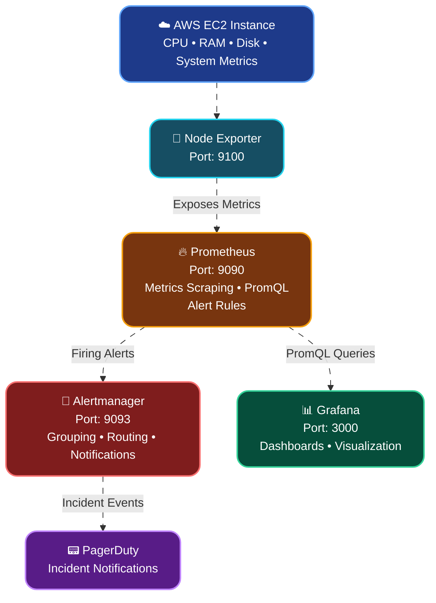

# 📊 Prometheus, Grafana & PagerDuty – Monitoring Architecture and Configuration Guide

A practical guide to monitoring AWS EC2 instances using Node Exporter, Prometheus, Grafana, Alertmanager, and PagerDuty.

This guide explains the complete monitoring architecture, component responsibilities, PromQL queries, alert rule configurations, notification routing, and how to create custom monitoring conditions.

---

## 🏗️ 1. Complete Monitoring Architecture

The monitoring architecture follows a metrics collection, evaluation, visualization, and alerting workflow.

### 🔄 Architecture Diagram



### 🔍 How the Architecture Works

1. **AWS EC2:** Hosts the application and operating system whose CPU, RAM, disk, and network metrics need monitoring.

2. **Node Exporter:** Runs on the EC2 instance and exposes system metrics through HTTP endpoint `:9100`.

3. **Prometheus:** Periodically scrapes metrics from Node Exporter, stores time-series data, and evaluates alert conditions written in PromQL.

4. **Alertmanager:** Receives firing alerts from Prometheus, groups related alerts, applies routing rules, and sends notifications.

5. **PagerDuty:** Receives incident events from Alertmanager and manages incident notifications and response workflows.

6. **Grafana:** Connects to Prometheus and displays metrics through dashboards, graphs, tables, and panels.

### 📌 Component Responsibilities

| Component | Port | Main Responsibility |
|---|---:|---|
| AWS EC2 | — | Hosts the monitored system |
| Node Exporter | 9100 | Collects system metrics |
| Prometheus | 9090 | Scrapes, stores, and evaluates metrics |
| Alertmanager | 9093 | Manages alert notifications |
| PagerDuty | — | Incident management |
| Grafana | 3000 | Metrics visualization |

**Important:** Grafana and Alertmanager are separate integrations with Prometheus. Grafana visualizes metrics, whereas Alertmanager handles notifications generated by Prometheus alert rules.

---

## 🔄 2. Understanding the Monitoring Workflow

Before writing configurations, understand how metrics travel through the architecture.

### Step 1: Node Exporter Collects Metrics

Node Exporter runs on the EC2 instance and exposes operating system metrics.

Example endpoint:

```text
http://<EC2_PRIVATE_IP>:9100/metrics
```

Some commonly available metrics:

| Metric | Description |
|---|---|
| `node_cpu_seconds_total` | CPU time spent in different modes |
| `node_memory_MemTotal_bytes` | Total system memory |
| `node_memory_MemAvailable_bytes` | Available system memory |
| `node_filesystem_size_bytes` | Filesystem size |
| `node_filesystem_avail_bytes` | Available filesystem space |
| `node_network_receive_bytes_total` | Network bytes received |
| `node_network_transmit_bytes_total` | Network bytes transmitted |

Node Exporter exposes metrics; Prometheus is responsible for collecting and storing them.

### Step 2: Prometheus Scrapes Metrics

Prometheus periodically requests the Node Exporter metrics endpoint.

For example:

```yaml
scrape_interval: 15s
```

This means Prometheus attempts to collect metrics every 15 seconds.

### Step 3: PromQL Evaluates Conditions

Prometheus uses PromQL to calculate metrics and evaluate conditions.

Example:

```promql
up == 0
```

If the monitored target is unavailable, this expression returns a result indicating that the target is down.

### Step 4: Prometheus Generates Alerts

When an alert expression becomes true, the alert enters the pending state.

If it remains true for the configured `for` duration, it becomes firing.

### Step 5: Alertmanager Sends Notifications

Alertmanager receives firing alerts and forwards them to configured receivers such as PagerDuty.

### Step 6: Grafana Displays Metrics

Grafana queries Prometheus and visualizes the collected metrics through dashboards.

---

## 📡 3. Node Exporter – Metrics Collection

Node Exporter is an agent that exposes hardware and operating system metrics for Prometheus.

### 🔍 Check Node Exporter Metrics

```bash
curl http://localhost:9100/metrics
```

### 📊 Check Specific Metrics

CPU:

```bash
curl -s http://localhost:9100/metrics | grep node_cpu_seconds_total
```

Memory:

```bash
curl -s http://localhost:9100/metrics | grep node_memory
```

Disk:

```bash
curl -s http://localhost:9100/metrics | grep node_filesystem
```

Network:

```bash
curl -s http://localhost:9100/metrics | grep node_network
```

> `grep` is used here only to filter command output. It is not required for installing or configuring Node Exporter.

---

## ⚙️ 4. Prometheus Configuration

Prometheus requires a configuration file named `prometheus.yml`.

This file tells Prometheus:

- How frequently to collect metrics.
- Which targets to monitor.
- Which alert rules to evaluate.
- Where Alertmanager is running.

### 📄 prometheus.yml

```yaml
global:
  scrape_interval: 15s
  evaluation_interval: 15s

rule_files:
  - "alert_rules.yml"

alerting:
  alertmanagers:
    - static_configs:
        - targets:
            - "localhost:9093"

scrape_configs:

  - job_name: "node-exporter"
    static_configs:
      - targets:
          - "<EC2_PRIVATE_IP>:9100"
```

### 🔍 Understanding Each Configuration

**1. global**

```yaml
global:
  scrape_interval: 15s
  evaluation_interval: 15s
```

Defines the default settings for Prometheus.

| Keyword | Meaning |
|---|---|
| `global` | Global configuration section |
| `scrape_interval` | Frequency of metrics collection |
| `evaluation_interval` | Frequency of alert rule evaluation |

For example, `15s` means Prometheus performs the operation every 15 seconds.

**2. rule_files**

```yaml
rule_files:
  - "alert_rules.yml"
```

Tells Prometheus where alert rule files are located.

You can add multiple rule files:

```yaml
rule_files:
  - "alert_rules.yml"
  - "application_rules.yml"
  - "database_rules.yml"
```

**3. alerting**

```yaml
alerting:
  alertmanagers:
    - static_configs:
        - targets:
            - "localhost:9093"
```

Defines the Alertmanager endpoint to which Prometheus sends firing alerts.

If Alertmanager is running on another EC2 instance, replace `localhost` with its reachable private IP or DNS name.

**4. scrape_configs**

```yaml
scrape_configs:
  - job_name: "node-exporter"
    static_configs:
      - targets:
          - "<EC2_PRIVATE_IP>:9100"
```

Defines which targets Prometheus should monitor.

| Keyword | Meaning |
|---|---|
| `scrape_configs` | List of scraping configurations |
| `job_name` | Logical name of a monitoring job |
| `static_configs` | Manually configured monitoring targets |
| `targets` | IP addresses and ports of monitored services |

### ➕ Add Multiple EC2 Instances

```yaml
scrape_configs:
  - job_name: "node-exporter"
    static_configs:
      - targets:
          - "10.0.1.10:9100"
          - "10.0.1.11:9100"
          - "10.0.2.10:9100"
```

Prometheus will scrape metrics from all three targets.

---

## 📐 5. Understanding PromQL

PromQL stands for **Prometheus Query Language**.

It is used to retrieve, calculate, aggregate, and evaluate time-series metrics collected by Prometheus.

### 🧩 Basic PromQL Structure

A PromQL expression can contain:

```text
metric_name{label="value"}[time_range]
```

Example:

```promql
node_cpu_seconds_total{mode="idle"}
```

Explanation:

| Part | Meaning |
|---|---|
| `node_cpu_seconds_total` | Metric name |
| `{}` | Label selector |
| `mode` | Metric label |
| `"idle"` | Label value |

This expression selects CPU metrics where the CPU mode is idle.

### 🔍 Important PromQL Functions

| Function / Operator | Purpose | Example |
|---|---|---|
| `rate()` | Calculates per-second average increase of a counter | `rate(metric[5m])` |
| `irate()` | Calculates instant per-second rate | `irate(metric[5m])` |
| `increase()` | Calculates counter increase over a time range | `increase(metric[5m])` |
| `avg()` | Calculates average | `avg(metric)` |
| `sum()` | Calculates total | `sum(metric)` |
| `max()` | Returns maximum | `max(metric)` |
| `min()` | Returns minimum | `min(metric)` |
| `by()` | Groups aggregation by labels | `avg by(instance)(metric)` |
| `without()` | Aggregates while excluding specified labels | `sum without(cpu)(metric)` |

### ⏱️ Understanding Time Ranges

PromQL supports time-range selectors.

```promql
metric_name[1m]
metric_name[5m]
metric_name[15m]
metric_name[1h]
```

For example:

```promql
rate(node_cpu_seconds_total[5m])
```

Calculates the average per-second increase of the selected counter over the previous five minutes.

### ⚖️ Comparison Operators

PromQL supports comparison operators:

| Operator | Meaning |
|---|---|
| `>` | Greater than |
| `<` | Less than |
| `>=` | Greater than or equal |
| `<=` | Less than or equal |
| `==` | Equal |
| `!=` | Not equal |

Example:

```promql
node_memory_MemAvailable_bytes < 1000000000
```

This selects time series where available memory is below approximately 1 GB.

### 🧮 Logical Operators

| Operator | Meaning |
|---|---|
| `and` | Returns matching series from both expressions |
| `or` | Combines matching series from either expression |
| `unless` | Excludes matching series |

Example:

```promql
up == 0 or node_memory_MemAvailable_bytes < 1000000000
```

This selects targets that are down or have less than approximately 1 GB of available memory.

---

## 🚨 6. Prometheus Alert Rules – Understanding YAML

Alert rules define the conditions under which Prometheus should generate alerts.

These rules are generally stored in a separate YAML file.

### 📄 alert_rules.yml

```yaml
groups:
  - name: server-alerts
    rules:

      - alert: HighCPUUsage
        expr: |
          100 - (
            avg by(instance) (
              rate(node_cpu_seconds_total{mode="idle"}[5m])
            ) * 100
          ) > 40
        for: 2m
        labels:
          severity: critical
        annotations:
          summary: "High CPU usage detected"
          description: "CPU usage is above 40% on {{ $labels.instance }}."
```

### 🔍 Understanding Every Keyword

**1. groups**

```yaml
groups:
  - name: server-alerts
```

Groups related alert rules together.

For example, you can create different groups for:

- Server monitoring
- Application monitoring
- Database monitoring
- Network monitoring

**2. rules**

```yaml
rules:
```

Contains the actual alert definitions.

One group can contain multiple alert rules.

**3. alert**

```yaml
alert: HighCPUUsage
```

Defines the alert name.

When the condition becomes active, Prometheus identifies the alert using this name.

You can choose your own descriptive name.

Examples:

```yaml
alert: HighCPUUsage
alert: HighMemoryUsage
alert: HighDiskUsage
alert: InstanceDown
```

**4. expr**

```yaml
expr: node_memory_MemAvailable_bytes < 1000000000
```

Defines the PromQL expression that Prometheus evaluates.

If the expression returns one or more matching time series, the corresponding alert becomes pending.

This is where you define your monitoring condition.

**5. for**

```yaml
for: 2m
```

Defines how long the condition must remain active before the alert becomes firing.

For example:

- Condition becomes true at 10:00.
- `for: 2m` is configured.
- Condition remains true.
- Alert becomes firing after the pending period completes.

This helps avoid alerts caused by temporary spikes.

**6. labels**

```yaml
labels:
  severity: critical
```

Adds labels to the generated alert.

You can define custom labels:

```yaml
labels:
  severity: critical
  environment: production
  team: devops
```

These labels can be used by Alertmanager for routing, grouping, and filtering.

**7. annotations**

```yaml
annotations:
  summary: "High CPU usage detected"
  description: "CPU usage is above 40% on {{ $labels.instance }}."
```

Provides human-readable information about the alert.

| Keyword | Purpose |
|---|---|
| `summary` | Short alert description |
| `description` | Detailed explanation |
| `{{ $labels.instance }}` | Inserts the instance label |
| `{{ $labels.severity }}` | Inserts the severity label |

Annotations help identify what happened and where it happened.

---

## 🖥️ 7. CPU Usage Alert – Complete Example

### 📄 PromQL Expression

```promql
100 - (
  avg by(instance) (
    rate(node_cpu_seconds_total{mode="idle"}[5m])
  ) * 100
) > 40
```

### 🔍 Understanding the Calculation

**Step 1: Select Idle CPU Metrics**

```promql
node_cpu_seconds_total{mode="idle"}
```

Selects CPU time-series data for idle CPU mode.

**Step 2: Calculate CPU Usage Rate**

```promql
rate(node_cpu_seconds_total{mode="idle"}[5m])
```

Calculates the average per-second increase in idle CPU time over five minutes.

**Step 3: Calculate Average Across CPU Cores**

```promql
avg by(instance) (
  rate(node_cpu_seconds_total{mode="idle"}[5m])
)
```

Groups the idle CPU rate by instance and calculates its average across CPU cores.

**Step 4: Convert Idle Percentage into Used Percentage**

```promql
100 - (
  avg by(instance) (
    rate(node_cpu_seconds_total{mode="idle"}[5m])
  ) * 100
)
```

CPU usage percentage = 100 − CPU idle percentage.

**Step 5: Apply Threshold**

```promql
... > 40
```

Returns instances where CPU usage exceeds 40%.

### 📄 Complete Alert Rule

```yaml
- alert: HighCPUUsage
  expr: |
    100 - (
      avg by(instance) (
        rate(node_cpu_seconds_total{mode="idle"}[5m])
      ) * 100
    ) > 40
  for: 2m
  labels:
    severity: critical
  annotations:
    summary: "High CPU usage detected"
    description: "CPU usage is above 40% on {{ $labels.instance }}."
```

---

## 🧠 8. RAM Usage Alert – Complete Example

### 📄 PromQL Expression

```promql
100 * (
  1 - (
    node_memory_MemAvailable_bytes /
    node_memory_MemTotal_bytes
  )
) > 80
```

### 🔍 Understanding the Calculation

**Step 1: Get Total Memory**

```promql
node_memory_MemTotal_bytes
```

Returns total system memory in bytes.

**Step 2: Get Available Memory**

```promql
node_memory_MemAvailable_bytes
```

Returns memory available for new applications without swapping.

**Step 3: Calculate Used Memory Percentage**

```promql
100 * (
  1 - (
    node_memory_MemAvailable_bytes /
    node_memory_MemTotal_bytes
  )
)
```

This calculates the percentage of memory that is not available.

**Step 4: Apply Threshold**

```promql
... > 80
```

Returns instances where memory usage exceeds 80%.

### 📄 Complete Alert Rule

```yaml
- alert: HighMemoryUsage
  expr: |
    100 * (
      1 - (
        node_memory_MemAvailable_bytes /
        node_memory_MemTotal_bytes
      )
    ) > 80
  for: 2m
  labels:
    severity: warning
  annotations:
    summary: "High memory usage detected"
    description: "Memory usage is above 80% on {{ $labels.instance }}."
```

---

## 💽 9. Disk Usage Alert – Complete Example

### 📄 PromQL Expression

```promql
100 * (
  1 - (
    node_filesystem_avail_bytes{
      fstype!~"tmpfs|overlay|squashfs"
    } /
    node_filesystem_size_bytes{
      fstype!~"tmpfs|overlay|squashfs"
    }
  )
) > 80
```

### 🔍 Understanding the Calculation

**Step 1: Get Available Filesystem Space**

```promql
node_filesystem_avail_bytes
```

Returns available filesystem space in bytes.

**Step 2: Get Total Filesystem Space**

```promql
node_filesystem_size_bytes
```

Returns total filesystem capacity in bytes.

**Step 3: Exclude Unwanted Filesystem Types**

```promql
fstype!~"tmpfs|overlay|squashfs"
```

The `!~` operator excludes filesystem types matching the regular expression.

This helps avoid monitoring temporary and virtual filesystems as ordinary disk partitions.

**Step 4: Calculate Used Disk Percentage**

```promql
100 * (
  1 - (
    node_filesystem_avail_bytes /
    node_filesystem_size_bytes
  )
)
```

**Step 5: Apply Threshold**

```promql
... > 80
```

Returns filesystems where disk usage exceeds 80%.

### 📄 Complete Alert Rule

```yaml
- alert: HighDiskUsage
  expr: |
    100 * (
      1 - (
        node_filesystem_avail_bytes{
          fstype!~"tmpfs|overlay|squashfs"
        } /
        node_filesystem_size_bytes{
          fstype!~"tmpfs|overlay|squashfs"
        }
      )
    ) > 80
  for: 2m
  labels:
    severity: warning
  annotations:
    summary: "High disk usage detected"
    description: "Disk usage is above 80% on {{ $labels.instance }}."
```

---

## 🔴 10. Instance Down Alert – Complete Example

This alert detects when Prometheus cannot scrape a monitoring target.

### 📄 PromQL Expression

```promql
up == 0
```

### 🔍 Understanding the Expression

Prometheus automatically generates the `up` metric for each scrape target.

| Value | Meaning |
|---|---|
| `1` | Scrape successful |
| `0` | Scrape failed |

If Node Exporter becomes unavailable, Prometheus can return `up = 0`.

### 📄 Complete Alert Rule

```yaml
- alert: InstanceDown
  expr: up{job="node-exporter"} == 0
  for: 1m
  labels:
    severity: critical
  annotations:
    summary: "Instance is down"
    description: "Prometheus cannot scrape {{ $labels.instance }}."
```

---

## 🧪 11. How to Create Your Own Alert – Practical Example

Suppose you want to create a new alert:

**Requirement:** Generate a warning if an EC2 instance receives more than 10 MB/s of network traffic over the last five minutes.

### Step 1: Find the Relevant Metric

Node Exporter provides:

```promql
node_network_receive_bytes_total
```

This metric is a counter representing total received network bytes.

### Step 2: Calculate Network Receive Rate

```promql
rate(node_network_receive_bytes_total[5m])
```

This calculates the average incoming bytes per second over five minutes.

### Step 3: Convert Bytes into Megabytes

```promql
rate(node_network_receive_bytes_total[5m]) / 1024 / 1024
```

This converts bytes per second into MiB per second.

### Step 4: Apply Your Condition

```promql
rate(node_network_receive_bytes_total[5m]) / 1024 / 1024 > 10
```

Now the expression selects network interfaces receiving more than 10 MiB/s.

### Step 5: Create the Alert Rule

```yaml
- alert: HighNetworkReceive
  expr: |
    rate(node_network_receive_bytes_total{
      device!~"lo|docker.*|veth.*"
    }[5m]) / 1024 / 1024 > 10
  for: 2m
  labels:
    severity: warning
  annotations:
    summary: "High network traffic detected"
    description: "Network receive rate is above 10 MiB/s on {{ $labels.instance }}."
```

### Step 6: Add the Rule to alert_rules.yml

Place the new alert under the existing `rules:` list.

### Step 7: Validate the Configuration

```bash
promtool check rules alert_rules.yml
```

### Step 8: Reload Prometheus

After validating the rule, reload Prometheus configuration.

If the Prometheus service was started with lifecycle reload enabled:

```bash
sudo systemctl reload prometheus
```

Alternatively, restart the service:

```bash
sudo systemctl restart prometheus
```

### Step 9: Verify the Alert

Open:

```text
http://<PROMETHEUS_SERVER_IP>:9090/alerts
```

You can also test the PromQL expression in:

```text
http://<PROMETHEUS_SERVER_IP>:9090/graph
```

> This network example evaluates each interface independently. For an instance-wide threshold, aggregate interface rates with `sum by(instance)(...)`. Also consider excluding interfaces that are not relevant to your application.

---

## 🧰 12. PromQL – Additional Useful Examples

You can create more monitoring conditions using the same approach.

### 🔌 Network Receive Rate

```promql
rate(node_network_receive_bytes_total[5m])
```

### 📤 Network Transmit Rate

```promql
rate(node_network_transmit_bytes_total[5m])
```

### 📊 Total Network Receive Rate per Instance

```promql
sum by(instance) (
  rate(node_network_receive_bytes_total[5m])
)
```

### 📊 Total Network Transmit Rate per Instance

```promql
sum by(instance) (
  rate(node_network_transmit_bytes_total[5m])
)
```

### 💽 Disk Available Space in Percentage

```promql
100 * (
  node_filesystem_avail_bytes /
  node_filesystem_size_bytes
)
```

### 🔍 CPU Usage by Instance

```promql
100 - (
  avg by(instance) (
    rate(node_cpu_seconds_total{mode="idle"}[5m])
  ) * 100
)
```

### 📊 Memory Available in GB

```promql
node_memory_MemAvailable_bytes / 1024 / 1024 / 1024
```

### 🚨 Detect Target Down

```promql
up == 0
```

---

## 🚦 13. Understanding Alert States

Prometheus alert rules have three important states.

| State | Meaning |
|---|---|
| Inactive | Alert condition is not currently active |
| Pending | Condition is active but `for` duration has not completed |
| Firing | Condition remained active for the configured duration |

### Example: High CPU Alert

Configuration:

```yaml
for: 2m
```

Suppose CPU usage crosses 40%.

```text
10:00 → CPU usage becomes 55%
10:00 → Alert enters Pending
10:01 → Condition remains true
10:02 → Alert enters Firing
```

If the condition becomes false before the pending duration completes, the alert returns to inactive.

When a firing alert later stops matching, Prometheus marks it resolved/inactive and sends the resolved notification through Alertmanager when configured.

---

## 🚨 14. Alertmanager Configuration

Alertmanager manages notifications generated by Prometheus.

Its responsibilities include:

- Grouping related alerts.
- Routing alerts to appropriate receivers.
- Controlling notification timing.
- Deduplicating repeated notifications.
- Sending resolved notifications.
- Applying inhibition rules.

### 📄 alertmanager.yml

```yaml
route:
  receiver: pagerduty

  group_by:
    - alertname
    - instance

  group_wait: 10s
  group_interval: 10s
  repeat_interval: 1h

receivers:
  - name: pagerduty

    pagerduty_configs:
      - routing_key: "<PAGERDUTY_INTEGRATION_KEY>"
        send_resolved: true
```

### 🔍 Understanding the Configuration

**1. route**

```yaml
route:
  receiver: pagerduty
```

Defines the default notification receiver.

Every alert matching this route is sent to the PagerDuty receiver unless another matching child route takes precedence.

**2. receiver**

```yaml
receivers:
  - name: pagerduty
```

Defines the destination or integration to which Alertmanager sends notifications.

A receiver can contain integrations such as PagerDuty, email, Slack, and other supported notification systems.

**3. group_by**

```yaml
group_by:
  - alertname
  - instance
```

Defines which alert labels are used to group notifications.

For example, multiple alerts with the same alert name and instance can be grouped together.

**4. group_wait**

```yaml
group_wait: 10s
```

Waits before sending the first notification for a newly created alert group.

**5. group_interval**

```yaml
group_interval: 10s
```

Controls how long Alertmanager waits before sending an updated notification for an existing group.

**6. repeat_interval**

```yaml
repeat_interval: 1h
```

Controls how frequently Alertmanager repeats notifications for alerts that remain firing.

**7. routing_key**

```yaml
routing_key: "<PAGERDUTY_INTEGRATION_KEY>"
```

Contains the PagerDuty Events API V2 integration key.

**8. send_resolved**

```yaml
send_resolved: true
```

Allows Alertmanager to send a resolved notification when the alert condition is no longer active.

---

## 🔀 15. Alertmanager – Custom Routing Example

Suppose you want:

- Critical alerts to PagerDuty.
- Warning alerts to email.

You can define separate receivers and routes.

```yaml
route:
  receiver: warning-email

  group_by:
    - alertname
    - instance

  routes:
    - matchers:
        - severity="critical"
      receiver: pagerduty

    - matchers:
        - severity="warning"
      receiver: warning-email

receivers:
  - name: pagerduty
    pagerduty_configs:
      - routing_key: "<PAGERDUTY_INTEGRATION_KEY>"
        send_resolved: true

  - name: warning-email
    email_configs:
      - to: "admin@example.com"
        from: "alerts@example.com"
        smarthost: "smtp.example.com:587"
        auth_username: "alerts@example.com"
        auth_password: "<SMTP_PASSWORD>"
        send_resolved: true
```

Here, the `severity` label added in Prometheus alert rules determines which receiver gets the notification.

> Configure valid SMTP credentials and your mail server settings before using the email receiver. Keep secrets outside the publicly accessible YAML file.

---

## 📟 16. PagerDuty Integration

PagerDuty receives incident events from Alertmanager.

### 🔑 Integration Steps

1. Log in to PagerDuty.
2. Open the relevant service.
3. Add an integration.
4. Select Events API V2.
5. Copy the integration key.
6. Configure the key in Alertmanager.
7. Restart or reload Alertmanager.
8. Generate a test alert and verify the incident.

### 📄 PagerDuty Configuration

```yaml
receivers:
  - name: pagerduty
    pagerduty_configs:
      - routing_key: "<PAGERDUTY_INTEGRATION_KEY>"
        send_resolved: true
```

### 🔔 Notification Workflow

```text
Prometheus detects an alert
          |
          v
Alert enters Firing state
          |
          v
Alertmanager receives alert
          |
          v
Alertmanager applies routing rules
          |
          v
PagerDuty receives event
          |
          v
Incident is created or updated
```

---

## 📊 17. Grafana – Dashboards and Visualization

Grafana connects to Prometheus to display collected metrics.

Unlike Alertmanager, Grafana's primary role in this architecture is visualization.

### 🔌 Step 1: Add Prometheus Data Source

Open Grafana:

```text
http://<GRAFANA_SERVER_IP>:3000
```

Navigate to:

```text
Connections → Data Sources → Add data source → Prometheus
```

Configure:

```text
Name: Prometheus
Type: Prometheus
URL: http://<PROMETHEUS_SERVER_IP>:9090
Access: Server
```

Save and test the connection.

### 📈 Step 2: Create Dashboard

Navigate to:

```text
Dashboards → New → New Dashboard → Add Visualization
```

Select Prometheus as the data source.

### 📊 Step 3: Add CPU Usage Panel

```promql
100 - (
  avg by(instance) (
    rate(node_cpu_seconds_total{mode="idle"}[5m])
  ) * 100
)
```

Set the panel unit to percent (0–100).

### 📊 Step 4: Add RAM Usage Panel

```promql
100 * (
  1 - (
    node_memory_MemAvailable_bytes /
    node_memory_MemTotal_bytes
  )
)
```

Set the panel unit to percent (0–100).

### 📊 Step 5: Add Disk Usage Panel

```promql
100 * (
  1 - (
    node_filesystem_avail_bytes /
    node_filesystem_size_bytes
  )
)
```

Set the panel unit to percent (0–100).

### 📊 Step 6: Add Network Panel

Incoming traffic:

```promql
sum by(instance) (
  rate(node_network_receive_bytes_total[5m])
)
```

Outgoing traffic:

```promql
sum by(instance) (
  rate(node_network_transmit_bytes_total[5m])
)
```

Set the units to bytes per second.

### 📋 Recommended Dashboard Panels

| Panel | Metric |
|---|---|
| CPU Usage | CPU utilization percentage |
| RAM Usage | Memory utilization percentage |
| Disk Usage | Filesystem utilization percentage |
| Network In | Incoming bytes per second |
| Network Out | Outgoing bytes per second |
| Instance Status | Prometheus `up` metric |

---

## 🧪 18. Validate and Reload Configurations

Always validate configurations before applying changes.

### 🔍 Validate Prometheus Configuration

```bash
promtool check config prometheus.yml
```

### 🔍 Validate Alert Rules

```bash
promtool check rules alert_rules.yml
```

### 🔍 Validate Alertmanager Configuration

```bash
amtool check-config alertmanager.yml
```

### 🔄 Reload Prometheus

If lifecycle reload is enabled:

```bash
sudo systemctl reload prometheus
```

Alternatively:

```bash
sudo systemctl restart prometheus
```

### 🔄 Restart Alertmanager

```bash
sudo systemctl restart alertmanager
```

### 🔍 Check Service Status

```bash
sudo systemctl status prometheus
```

```bash
sudo systemctl status alertmanager
```

```bash
sudo systemctl status node_exporter
```

---

## 🔎 19. Troubleshooting

### ❌ Prometheus Target is Down

Check Node Exporter:

```bash
sudo systemctl status node_exporter
```

Check the metrics endpoint:

```bash
curl http://localhost:9100/metrics
```

Check the Prometheus targets page:

```text
http://<PROMETHEUS_SERVER_IP>:9090/targets
```

Verify:

- Node Exporter is running.
- Correct private IP and port are configured.
- AWS Security Group allows inbound TCP 9100 from the Prometheus server.
- Network connectivity is available.

### ❌ Prometheus Cannot Connect to Alertmanager

Check:

```bash
sudo systemctl status alertmanager
```

Verify the configured Alertmanager endpoint:

```yaml
alerting:
  alertmanagers:
    - static_configs:
        - targets:
            - "<ALERTMANAGER_PRIVATE_IP>:9093"
```

### ❌ PagerDuty Is Not Receiving Alerts

Check:

- Correct Events API V2 integration key.
- Correct Alertmanager receiver configuration.
- Alertmanager logs.
- Whether the Prometheus alert is actually firing.
- Whether routing rules match the alert labels.

### ❌ Grafana Cannot Connect to Prometheus

Check:

- Prometheus service status.
- Prometheus endpoint URL.
- Network connectivity between Grafana and Prometheus.
- AWS Security Group rules.
- Whether the Prometheus API is accessible from the Grafana server.

---

## 🛡️ 20. Security Best Practices

- Restrict Node Exporter port 9100 to the Prometheus server.
- Restrict Prometheus and Alertmanager ports to trusted networks.
- Avoid exposing Grafana publicly without authentication and HTTPS.
- Protect PagerDuty integration keys.
- Keep credentials outside public configuration repositories.
- Use private IP addresses for internal monitoring traffic.
- Apply least-privilege permissions.
- Monitor the monitoring infrastructure itself.
- Validate configuration files before applying changes.

---

## 📚 21. Official Documentation

- [Prometheus Documentation](https://prometheus.io/docs/introduction/overview/)
- [Prometheus Configuration](https://prometheus.io/docs/prometheus/latest/configuration/configuration/)
- [PromQL Documentation](https://prometheus.io/docs/prometheus/latest/querying/basics/)
- [Prometheus Alerting Rules](https://prometheus.io/docs/prometheus/latest/configuration/alerting_rules/)
- [Prometheus Node Exporter](https://github.com/prometheus/node_exporter)
- [Alertmanager Documentation](https://prometheus.io/docs/alerting/latest/alertmanager/)
- [Alertmanager Configuration](https://prometheus.io/docs/alerting/latest/configuration/)
- [Grafana Documentation](https://grafana.com/docs/grafana/latest/)
- [Grafana Prometheus Data Source](https://grafana.com/docs/grafana/latest/datasources/prometheus/)
- [PagerDuty Documentation](https://support.pagerduty.com/)

---

**🚀 Monitor • Analyze • Alert • Respond**